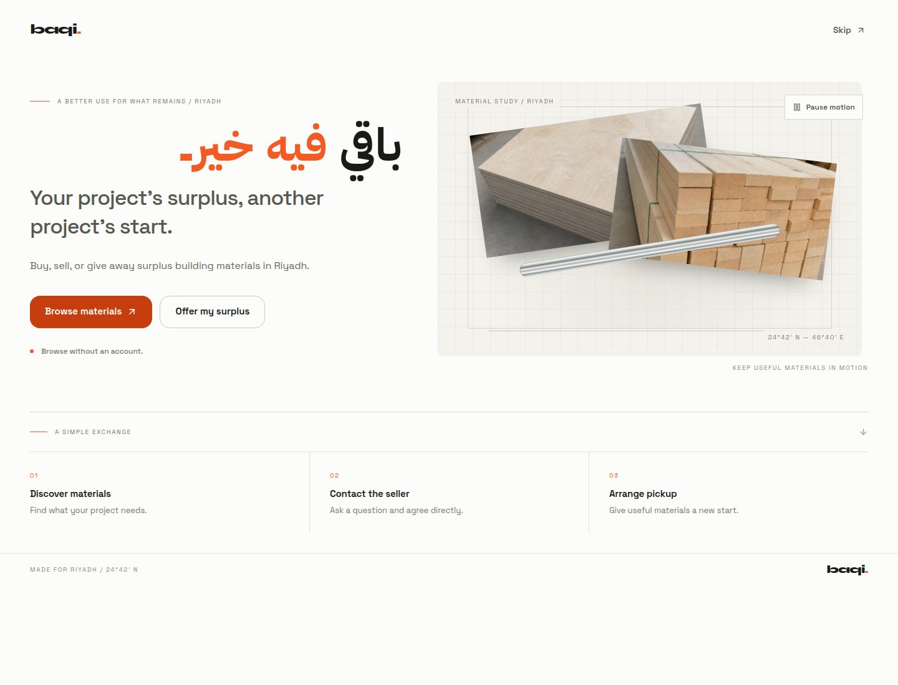

<div align="center">

# باقي · Baqi

### Build for less. Give surplus a second life.

A bilingual marketplace for buying, selling, and giving away surplus construction materials in Riyadh.

**English & العربية · Local pickup · Smart search and photo assistance**

[Try Baqi](https://baqi-mvp.replit.app/)

  


<p align="center">
  
</p>

<em>Browse public listings, find materials nearby, and arrange pickup directly with the seller.</em>

[Features](#features) · [How it works](#how-it-works) · [Getting started](#getting-started) · [Development](#development) · [بالعربية](#بالعربية)

</div>

---

Baqi connects people who have leftover building materials with people who can use them. Browse public listings without an account, find materials nearby, and arrange pickup directly with the seller.

> **MVP status:** Deposits, card and Mada payments, wallet balances, and withdrawals are simulations. No real funds move.

## Features

| Area | What you can do |
| --- | --- |
| Bilingual experience | First-visit welcome with animated materials artwork, English and Arabic interface, an Account-page language setting, right-to-left layout, and reduced-motion support. |
| Material discovery | Describe what you need in Arabic or English, search with a photo, filter listings, browse free materials, and sort by price. |
| Selling | Upload photos, choose partial or full-lot sales, and control whether your phone number is visible. |
| Conversations | Message sellers to ask questions and arrange collection. |
| Reservations and orders | Reserve materials, follow order progress, and try the simulated 10% deposit flow. |
| Seller wallet | View wallet activity and try simulated withdrawals. |
| Photo assistance | OpenAI-powered smart text/photo search and seller listing suggestions; Gemini visual matching for saved-search alerts. |

## How it works

1. **Find materials.** Browse surplus listings across Riyadh and check the quantity, condition, neighborhood, and price per unit.
2. **Ask and reserve.** Sign in to message the seller and reserve materials. Free items use a pickup request.
3. **Collect locally.** Arrange pickup with the seller, collect the materials, and confirm receipt through the order flow.

An account is required to sell, message, reserve, and manage orders. Public browsing and text search are available without signing in.

## Tech stack

| Layer | Technology |
| --- | --- |
| Web app | React 19, TypeScript, Vite, Tailwind CSS |
| Routing and data | Wouter, TanStack Query |
| Authentication | Clerk |
| API | Node.js, Express 5, Zod |
| Database | PostgreSQL, Drizzle ORM |
| API contracts | OpenAPI, Orval-generated clients and schemas |
| AI assistance | OpenAI for smart search and listing suggestions; Gemini for saved-search visual matching |
| Workspace | pnpm workspaces |

## Getting started

The project is configured for a Replit environment, including managed authentication routing, object storage, and optional AI integrations.

### 1. Install dependencies

Use Node.js 24 and pnpm. The workspace requires pnpm rather than npm or Yarn.

```sh
git clone https://github.com/turki125/Baqi.git
cd Baqi
pnpm install --frozen-lockfile
```

### 2. Configure services

| Configuration | Purpose |
| --- | --- |
| `DATABASE_URL` | PostgreSQL connection string for the API and database tooling. |
| Clerk configuration | Authentication for the web app and API. Local setups can supply `VITE_CLERK_PUBLISHABLE_KEY`, `CLERK_PUBLISHABLE_KEY`, and `CLERK_SECRET_KEY`. |
| `PORT` | Listening port for each process; use separate ports for the web app and API. |
| `BASE_PATH` | Web app base path, such as `/`. Required by the Vite configuration. |
| Replit object storage | Listing photo uploads and private reference photos. |
| OpenAI key | Set `OPENAI_API_KEY` or `OpenAiKey` in Replit Secrets for smart search and seller suggestions. |
| Replit Gemini integration | Optional saved-search visual matching. |

Store credentials in your environment or Replit Secrets. Never commit them to the repository. Local development requires routing `/api` requests to the API server; the repository does not configure a Vite API proxy.

### 3. Prepare the development database

After configuring `DATABASE_URL`, apply the development schema:

```sh
pnpm --filter @workspace/db run push
```

This command changes the connected database schema. Use a development database.

### 4. Run the app

Use the configured Replit workflows, or start the API and web app in separate terminals with the required environment variables:

```sh
# API
PORT=5000 pnpm --filter @workspace/api-server run dev

# Web app
PORT=5173 BASE_PATH=/ pnpm --filter @workspace/baqi run dev
```

The existing native dependency overrides target Linux. Other platforms may need additional native build-tool setup.

## Development

Run these commands from the repository root:

| Command | Purpose |
| --- | --- |
| `pnpm run typecheck` | Check TypeScript across the workspace. |
| `PORT=5173 BASE_PATH=/ pnpm run build` | Type-check and build the workspace. |
| `pnpm --filter @workspace/api-spec run codegen` | Regenerate API clients and Zod schemas from OpenAPI. |
| `pnpm --filter @workspace/db run push` | Apply database schema changes in development. |

### Repository structure

```text
artifacts/
  baqi/                 React marketplace app
  api-server/           Express API and service integrations
  mockup-sandbox/       UI preview sandbox
lib/
  api-spec/             OpenAPI contract and code generation
  api-client-react/     Generated React API client
  api-zod/              Generated request and response schemas
  db/                   Database connection and Drizzle schemas
scripts/                Workspace utilities
```

Update the OpenAPI contract and regenerate its clients when changing API interfaces. Database schemas live in `lib/db/src/schema`.

## AI assistance

OpenAI powers smart text/photo search and seller photo suggestions. Configure `OPENAI_API_KEY` or `OpenAiKey` in Replit Secrets. Saved-search visual matching uses the optional managed Gemini integration. Keep provider credentials in Secrets; never commit them to this repository.

### Search in your own words

Type what you need in Arabic or English and select **Search**. Baqi looks for the material and any quantity, unit, size, or condition you mention. You can also use the filters yourself. Text search does not require an account. If smart search is unavailable, Baqi uses regular text search.

### Suggest listing details

Sign in and upload a cover photo while creating a listing. Baqi automatically suggests a short Arabic title, category, and description after the upload finishes. Review the suggestions and choose **Apply selected** to fill empty fields. Anything you already entered stays unchanged. You can retry with **Suggest details** or enter the details yourself.

You set the condition, quantity, price, sale rules, exact dimensions, and pickup location yourself.

### Search with a photo

On Browse, choose **Search with a photo**. Add a reference image and, optionally, describe what else should match. Baqi analyzes the photo and text together. You can also set category, condition, free-only filters, or a minimum quantity in an exact unit, including custom units. Quantities are not converted between units or pooled across listings.

Visual search compares up to 12 recent qualifying listings with usable photos. Similarity is an estimate, not proof of dimensions, model, grade, authenticity, or safety. Verify the material details with the seller.

### Privacy and limits

- Sign in to upload a private reference photo or request listing suggestions.
- JPEG, PNG, and WebP uploads are limited to 10 MB and resized before analysis.
- Reference photos remain private. A listing photo becomes public when its owner publishes the listing.
- Text search starts when you select **Search**. Photo search starts when you submit a reference photo. Seller suggestions start automatically after a cover photo uploads; applying them is your choice.
- Text search allows up to six requests per minute and 40 per hour per account, or per IP address for guests. Photo assistance allows five requests per minute per account and two simultaneous analyses per server.
- If assistance fails, manual listing entry and normal text search remain available.

## بالعربية

**باقي** سوق ثنائي اللغة لفائض مواد البناء في الرياض. اشترِ ما تحتاجه، أو بِع المواد المتبقية من مشروعك، أو تبرّع بها لمن يستفيد منها.

- تصفّح الإعلانات وابحث عن المواد دون إنشاء حساب.
- سجّل الدخول لعرض موادك، ومراسلة البائعين، وحجز الكميات، ومتابعة الطلبات.
- استخدم الواجهة العربية مع دعم العرض من اليمين إلى اليسار.
- رتّب الاستلام مباشرة مع البائع داخل الرياض.
- استخدم البحث الذكي واقتراحات تفاصيل الإعلان، مع مطابقة الصور في تنبيهات البحث المحفوظة عند تفعيل التكامل.

> العربون والمدفوعات والمحفظة والسحوبات في هذه النسخة محاكاة فقط؛ لا تنتقل أموال حقيقية.
