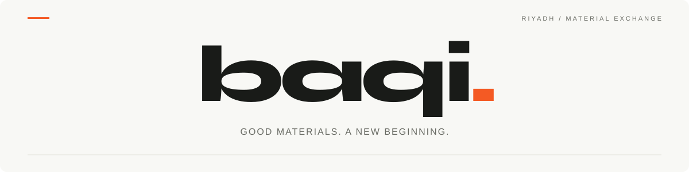
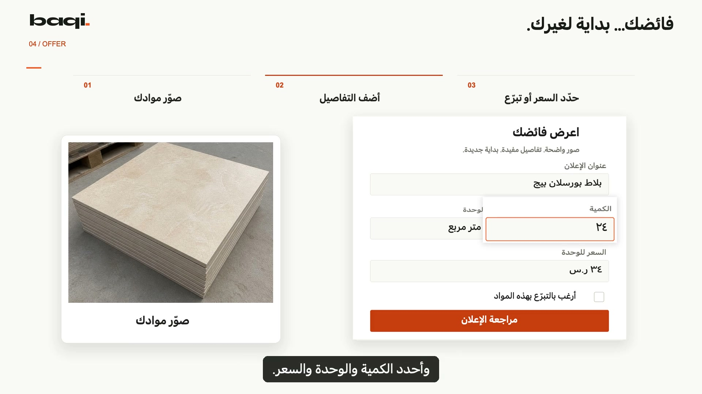
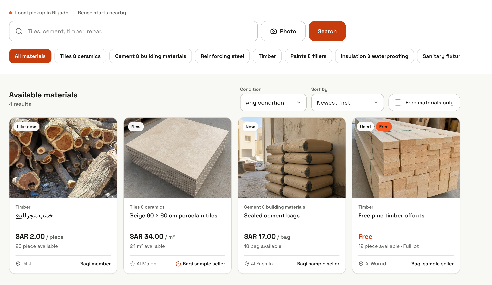
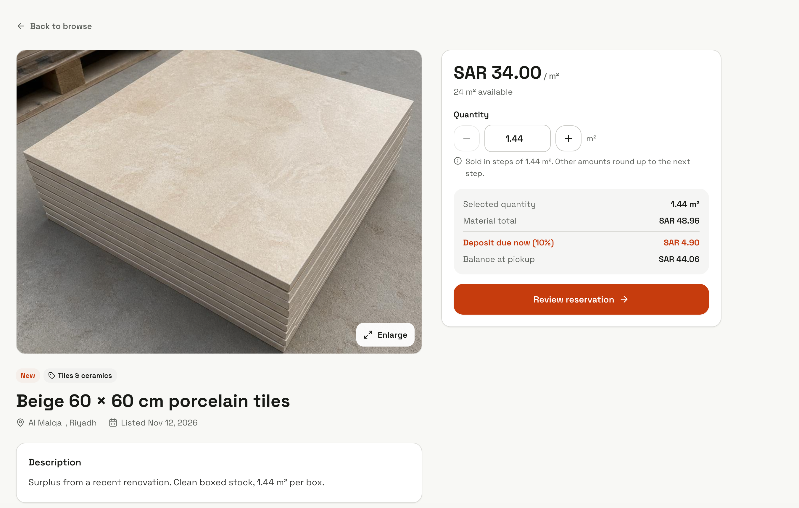
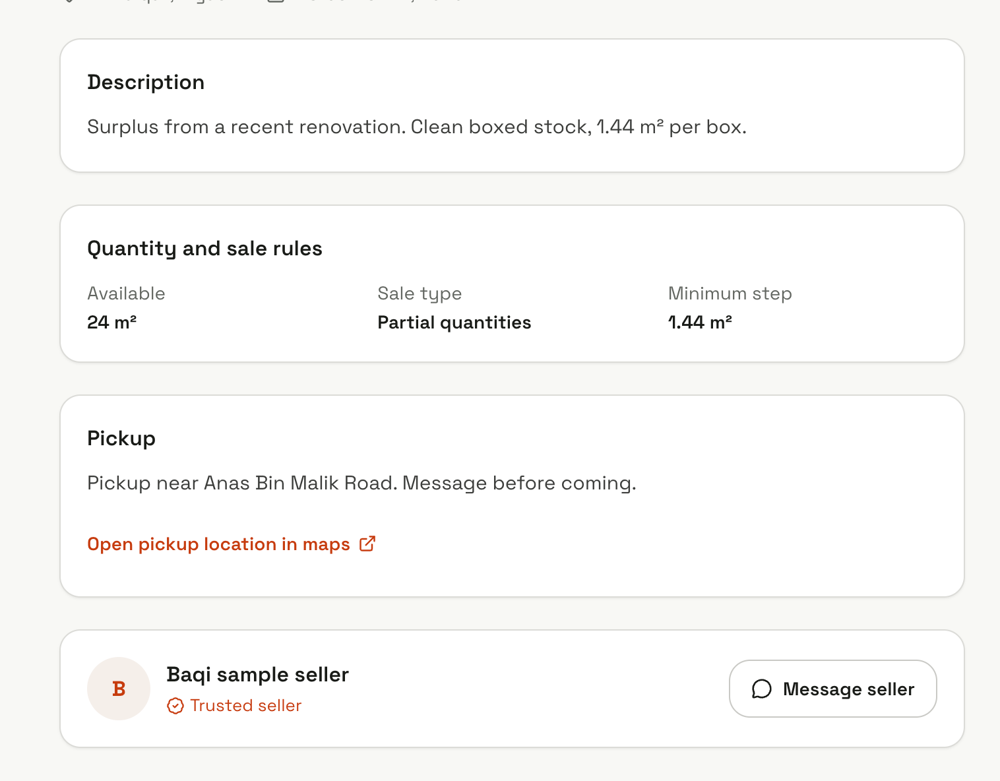
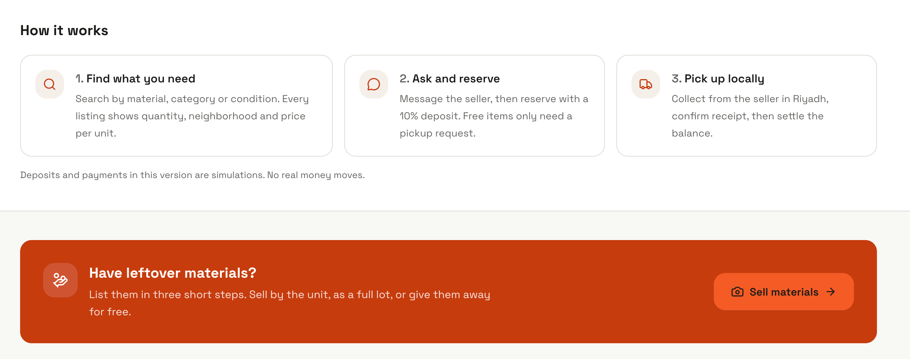
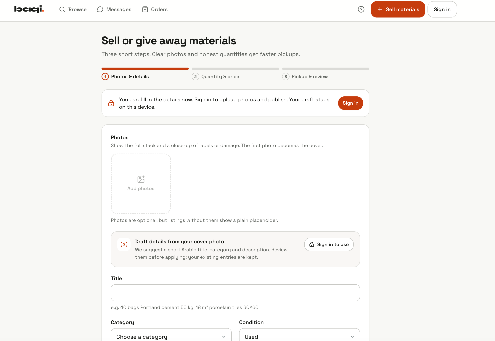
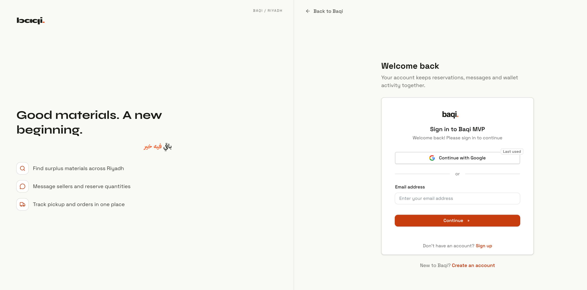
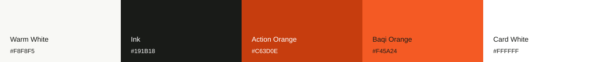

<div align="center">



# باقي · Baqi

**Buy, sell, or give surplus building materials a second life.**

English & العربية · Local pickup in Riyadh · Smart text and photo search

[**Try Baqi ↗**](https://baqi-mvp.replit.app/) · [**Watch the demo ▶**](https://baqi-team.netlify.app/demo/) · [**Meet the team ↗**](https://baqi-team.netlify.app/)

  

</div>

## The idea

One project ends. Another begins.

Baqi connects people with leftover tiles, timber, cement, and other building materials with people who can use them. Sell by the unit or as a full lot, give materials away, and arrange pickup directly with the seller in Riyadh.

## Demo video

[](https://baqi-team.netlify.app/demo/)

**1 minute 36 seconds · Arabic narration · 1080p**

[Open the video player ↗](https://baqi-team.netlify.app/demo/) · [Download the original MP4](https://github.com/turki125/Baqi/raw/refs/heads/main/docs/media/baqi-demo.mp4)

## What you can do

- **Find materials:** browse without an account, filter by category or condition, compare prices per unit, and find free items.
- **Search naturally:** describe what you need in Arabic or English, or combine a reference photo with text.
- **List your surplus:** add photos, set quantity and price, choose partial or full-lot sales, or offer materials for free.
- **Get help with listing details:** review AI suggestions for an Arabic title, category, and description. Existing entries stay unchanged.
- **Connect and collect:** message the seller, reserve materials, and follow the order through local pickup.
- **Use either language:** Arabic and English interfaces, right-to-left Arabic layouts, and a language setting in Account.

**The journey:** Find → Ask → Reserve → Pick up

An account is required to upload photos, publish listings, message, or reserve. Public browsing and text search are available without signing in.

> **Demo payments:** Deposits, payments, wallet balances, and withdrawals are simulations. No real money moves.

## Screenshots

Your view of the marketplace, from discovery to pickup. Open any image to see it at full size.

<details open>
<summary><strong>Browse materials and inspect a listing</strong></summary>
<br />

<table>
  <tr>
    <td width="50%"><a href="docs/images/baqi-catalog.png"></a><br /><sub>Search, filter, and compare available materials.</sub></td>
    <td width="50%"><a href="docs/images/baqi-listing.png"></a><br /><sub>Review photos, quantity, and price per unit.</sub></td>
  </tr>
</table>

</details>

<details>
<summary><strong>Pickup details and how it works</strong></summary>
<br />

<table>
  <tr>
    <td width="50%"><a href="docs/images/baqi-pickup.png"></a><br /><sub>Check sale rules and arrange local collection.</sub></td>
    <td width="50%"><a href="docs/images/baqi-how-it-works.png"></a><br /><sub>A simple journey from finding materials to pickup.</sub></td>
  </tr>
</table>

</details>

<details>
<summary><strong>Selling and signing in</strong></summary>
<br />

<table>
  <tr>
    <td width="50%"><a href="docs/images/baqi-sell.png"></a><br /><sub>List surplus in three short steps.</sub></td>
    <td width="50%"><a href="docs/images/baqi-sign-in.png"></a><br /><sub>Sign in to publish, message, and reserve.</sub></td>
  </tr>
</table>

</details>

## Design system

**White, ink, and orange.** A quiet background gives the materials room, while orange highlights the next action.



| Color | Hex | Used for |
| --- | --- | --- |
| Warm White | `#F8F8F5` | Page backgrounds |
| Ink | `#191B18` | Text and icons |
| Action Orange | `#C63D0E` | Primary buttons and important actions |
| Baqi Orange | `#F45A24` | Brand accents and highlights |
| Card White | `#FFFFFF` | Forms and material cards |

**Typography:** Syne for the wordmark, Space Grotesk for the interface, and IBM Plex Sans Arabic for Arabic text.

**Motion:** animated material artwork, gentle entrances, and reduced-motion support.

## Built with

| Layer | Technologies |
| --- | --- |
| Web app | React 19, TypeScript, Vite, Tailwind CSS |
| Routing and data | Wouter, TanStack Query |
| API | Node.js, Express 5, Zod |
| API contracts | OpenAPI, Orval-generated React client and schemas |
| Database | PostgreSQL, Drizzle ORM |
| Authentication | Clerk |
| AI | OpenAI for smart search and listing suggestions; optional Gemini matching for saved-search alerts |
| Development | Replit, pnpm workspaces |

AI helps interpret requests and draft suggestions. Database filters apply search criteria; regular text search and manual listing entry remain available if AI is unavailable.

## Run the project

The app is configured for Replit, with authentication, PostgreSQL, and object storage. OpenAI credentials enable smart search and listing suggestions.

```sh
git clone https://github.com/turki125/Baqi.git
cd Baqi
pnpm install --frozen-lockfile
```

Then configure your services and run the API and frontend using the [development guide](docs/DEVELOPMENT.md). It includes environment variables, database setup, local commands, and AI limits.

## The team

| Name | Role | Connect |
| --- | --- | --- |
| Turki Turki | Team lead · قائد الفريق | [LinkedIn](https://www.linkedin.com/in/turki-turki-321b79378/) |
| Anas Almuziel | Team member · عضو الفريق | [LinkedIn](https://www.linkedin.com/in/anas-almuziel-a891733ab/) |
| abdulrahman alhailan | Team member · عضو الفريق | [LinkedIn](https://www.linkedin.com/in/abdulrahmannnn/) |

## بالعربية

**باقي** منصة لفائض مواد البناء في الرياض. اشترِ ما تحتاجه، أو بِع المواد المتبقية من مشروعك، أو تبرّع بها لمن يستفيد منها. ابحث بالعربية أو الإنجليزية، تواصل مع البائع، ورتّب الاستلام محلياً.

**نهاية مشروعك، ممكن تكون بداية مشروع غيرك. باقي فيه خير.**
